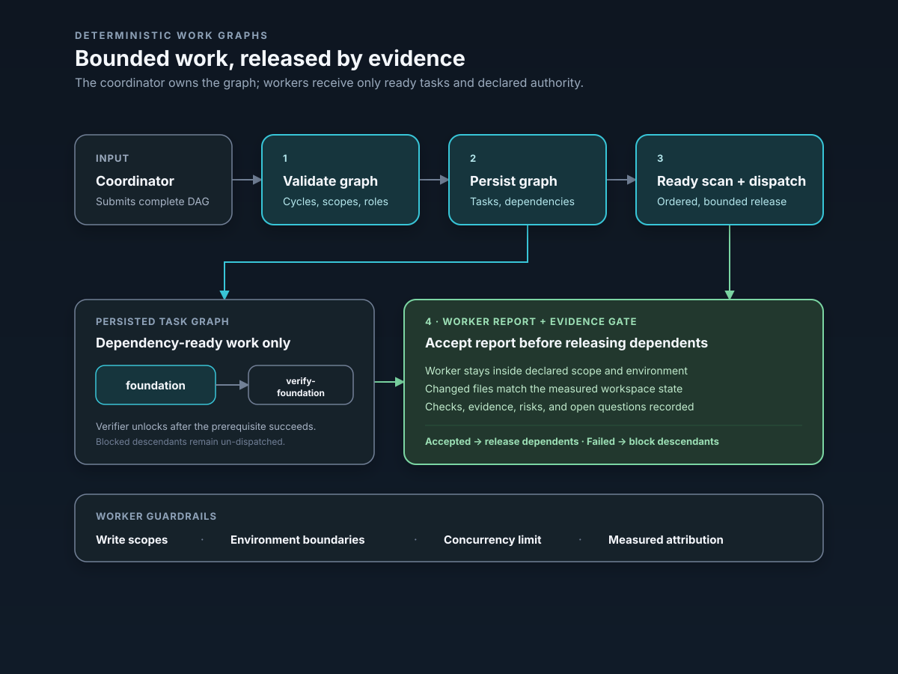

# Deterministic Work Graphs

Status: on by default (`enable_fanout`, [features](../codex-rs/features/src/lib.rs)); the
desktop app's Workflows run on it. Awaiting Masih's functional acceptance.



## Objective

A work graph leaves agents only bounded judgment. Elpis validates the plan, persists
it, selects dependency-ready work, enforces concurrency and write boundaries, and
accepts evidence before releasing dependent work.

## Graphs

Elpis keeps two separate graphs:

- the **lineage graph** records which agent spawned which subagent;
- the **work graph** records tasks, dependencies, scopes, assignments, and outcomes.

The work graph must be a directed acyclic graph (DAG): a task in a cycle would wait on
itself.

## Enable and use

`enable_fanout = false` under `[features]` turns it off. There is no slash command. The coordinator model receives the
`run_agent_work_graph` function tool and supplies the complete graph:

```json
{
  "name": "bounded change",
  "max_concurrency": 2,
  "max_runtime_seconds": 1800,
  "tasks": [
    {
      "id": "foundation",
      "title": "Build the narrow foundation",
      "instruction": "Implement the bounded behavior and run its focused checks.",
      "kind": "implement",
      "depends_on": [],
      "write_scopes": ["codex-rs/state"],
      "acceptance_criteria": ["focused state test passes"],
      "environment_id": "primary"
    },
    {
      "id": "verify-foundation",
      "title": "Verify the foundation independently",
      "instruction": "Inspect the accepted result and run the acceptance check.",
      "kind": "verify",
      "depends_on": ["foundation"],
      "write_scopes": [],
      "acceptance_criteria": ["focused core test passes"],
      "environment_id": "primary"
    }
  ]
}
```

Write scopes are existing repository-relative directories; a task may create, modify,
or delete files beneath them. Exact-file mount roots are rejected, because the inherited
Linux sandbox applies directory metadata protections to writable roots.
`environment_id` must name an environment already selected for the turn. Without worktree
isolation, Elpis creates, merges, and deletes no branches or worktrees. With it, Elpis
creates, commits, merges, and removes only its own `elpis/<graph>/<task>` branches and
worktrees. It never rebases or pushes.

## Worktree isolation

`workGraph/run` and `workGraph/runWithProviders` accept `isolation: "worktree"` (the
desktop bridge forwards it from `runWorkflow`); absent or null keeps the behaviour above.
Masih approved this design on 17 October 2026.

- Each `implement` or `fix` task gets its own git worktree when it becomes ready, at
  `<parent of the repository>/<repository name>-elpis/<graph id>/<task id>` (or that path
  under the desktop's `desktop.git-worktree-root` when set), on the branch
  `elpis/<graph id>/<task id>`.
- A writer with no writer prerequisites starts from the root's HEAD at run start.
  A writer that builds on writers (directly or through read-only tasks) starts from the
  first one's result and merges the others with `git merge --no-ff`. A clash fails that
  task, lists the clashing files, and keeps the conflicted worktree.
- The writer's `verify` task checks the same worktree; each `verify` task must depend
  directly on exactly one writer. Writers in different worktrees run in parallel; write
  scopes stay relative to the worktree and are enforced as before. `explore` tasks run in
  the selected environment itself.
- When all of a writer's `verify` tasks succeed, Elpis commits everything changed in its
  worktree as `Elpis agent`, with the task title as the message. An unchanged worktree
  adds no commit.
- When the whole graph succeeds, Elpis merges the results of writers no other writer
  builds on with `git merge --no-ff`, one by one, first in a scratch worktree, then into
  the root's checked-out branch by fast-forward, so the branch gets the same merge
  commits. If a result clashes, or the root has uncommitted changes in a file the merge
  would change, the branch does not move; the graph fails, lists those files, and keeps
  the branches and worktrees. After a merge Elpis removes the worktrees and
  `elpis/<graph id>/*` branches.
- A failed or cancelled run removes worktrees that hold no work and keeps and names
  those that do.
- The report (worktree paths, branches, merge outcome) is the graph's `worktreeReport`
  in `workGraph/list`, and is added to the graph's `error` when the run fails.

Commits and merges skip the repository's commit hooks (`--no-verify`) and signing.

## Deterministic engine rules

Before dispatch, Elpis rejects:

- empty graphs, duplicate or malformed task IDs, unknown or repeated dependencies;
- self-dependencies and dependency cycles;
- absolute, empty, escaping, missing, or non-directory write scopes;
- unknown selected environments;
- missing acceptance criteria or an unknown task role;
- write scopes on `explore` or `verify` tasks;
- `implement` or `fix` tasks without write scopes;
- a writable task without a directly dependent `verify` task in the same environment;
- zero concurrency or runtime limits.

Kahn's topological algorithm checks that the graph is acyclic, and path-prefix intersection
detects write conflicts. At runtime:

1. Tasks are persisted in declared order.
2. Only pending tasks whose dependencies all succeeded are eligible.
3. Eligible tasks are selected in declared order, then task-ID order.
4. All writable tasks in one workspace are serialized, even when their path prefixes do
   not overlap.
5. Writable tasks run concurrently only in different selected environments or, with
   worktree isolation, in their own worktrees.
6. Concurrency is bounded by the requested limit and the session agent limit.
7. A failed, cancelled, or blocked prerequisite blocks its pending descendants.
8. Each task has a runtime deadline; a worker that exits without an accepted report
   fails the task.
9. Cancellation shuts down active workers and records the graph as terminal.

Dispatch is therefore repeatable for the same persisted state. Model completion time is
not deterministic, but it cannot make an ineligible task runnable or bypass a scope
conflict.

## Worker authority and evidence

Each worker receives:

- one role, one task, one selected environment, exact write scopes, and acceptance
  criteria;
- accepted prerequisite results and evidence;
- only the worker report tool of the work-graph tool pair;
- no collaboration tools for creating subagents.

The engine derives a managed permission profile for every worker:

- the filesystem is readable;
- only declared repository-relative scopes are writable;
- an empty scope list is read-only;
- network access is restricted.

The child profile cannot broaden the parent's: parent read denials survive, and a
declared write scope must already be writable under the coordinator's active profile.
Windows-style absolute paths, Git metadata paths, and scopes whose existing prefix
resolves through a symlink outside the selected workspace are rejected.

The sandbox enforces this, not only the prompt. Before dispatching a writable task,
Elpis records SHA-256 digests of files and symlinks in its workspace, excluding Git
metadata and ignored paths, and measures again when the assigned thread reports. Every
declared file must be among the measured created, modified, and deleted files, and every
measured change must lie within the task's write scopes. Other changes within those
scopes, such as generated caches, are accepted and recorded as `undeclared_changed_files`
in the task result and in the run log's terminal event.

`report_agent_work_task` is accepted only from the assigned thread. Success requires
concrete checks and evidence; writable success requires a measured changed file. Every
report records summary, changed files, checks, risks, edge cases considered, open
questions, evidence, what was not checked, and failure reason. Declared paths outside
the task's scopes are rejected.

Elpis validates authority, structure, and file attribution. It cannot prove that prose,
checks, or acceptance criteria are good: the directly dependent `verify` task,
coordinator review, and Masih's acceptance remain required.

## Visibility

The app server exposes a root thread's persisted graphs through `workGraph/list`.
Opening `/agent` fetches the newest graph and renders:

- graph and task state, role, dependencies, and assigned thread;
- summary and measured changed files;
- checks, evidence, risks, edge cases, and open questions;
- unchecked work and terminal failure reasons.

The view is a snapshot taken when `/agent` opens, not a live dashboard. The existing
`/subagents` alias reaches the same view.

## Persistence and interruption

SQLite stores:

- graph identity, root thread, status, limits, timestamps, and final error;
- task order, instruction, dependencies, scopes, criteria, environment/workspace,
  assigned thread, attempts, result, evidence, and failure;
- an append-only transition event trail.

If a coordinator is interrupted and the same root thread starts another work graph,
Elpis first fails that root's unfinished graph and tasks. It never requeues an old
active claim, so it never deliberately assigns two workers the same persisted task, and it never
resumes partial work automatically: the coordinator must inspect accepted evidence and
build the next graph.

## Verification

Tests: [handler](../codex-rs/core/src/tools/handlers/work_graphs_tests.rs),
[spec](../codex-rs/core/src/tools/handlers/work_graphs_spec_tests.rs),
[worktrees](../codex-rs/core/src/tools/handlers/work_graph_worktrees_tests.rs),
[core suite](../codex-rs/core/tests/suite/work_graphs.rs) and
[app server](../codex-rs/app-server/tests/suite/v2/elpis_work_graphs.rs). Before/after
negative-check data and reproduction commands:
[evals/accountable-work-graphs](evals/accountable-work-graphs/README.md).
