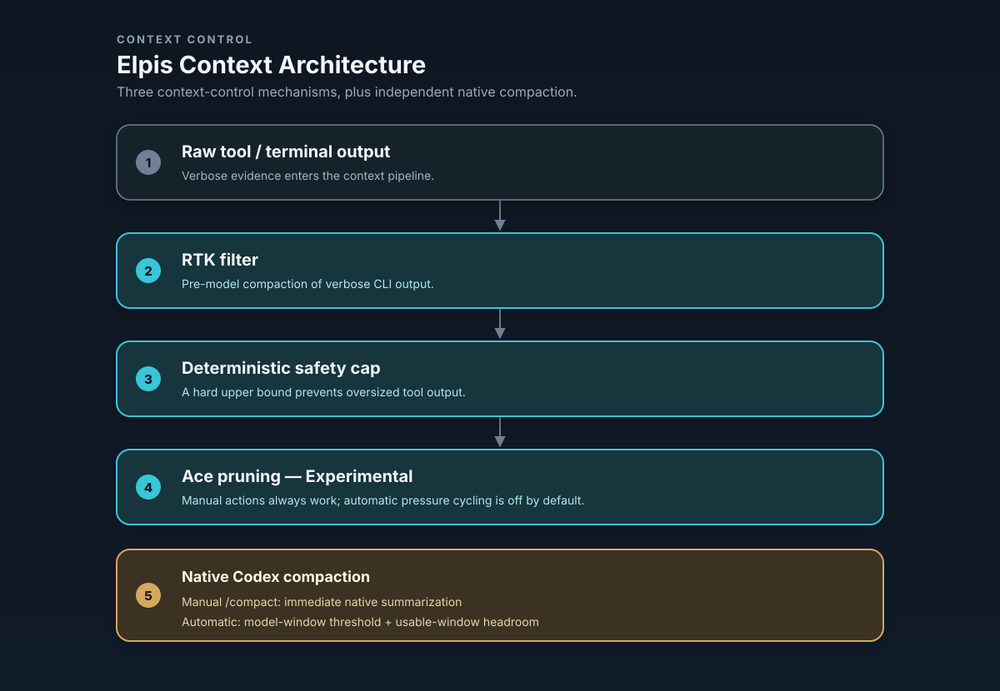
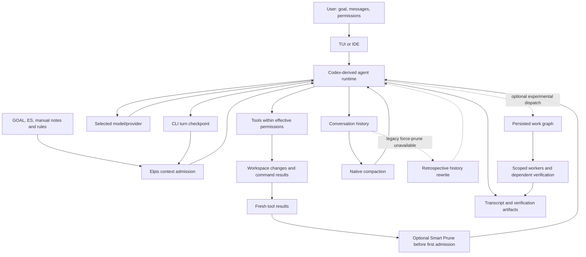
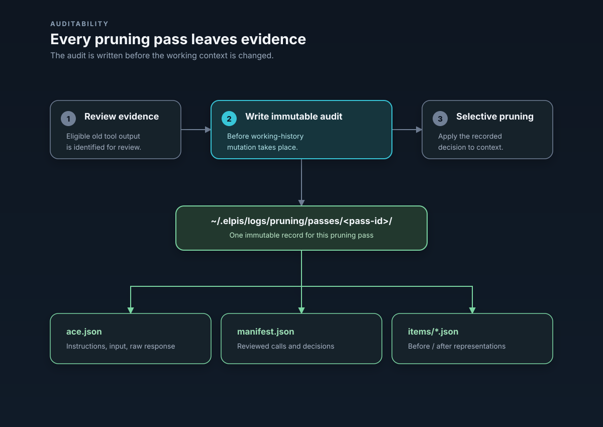
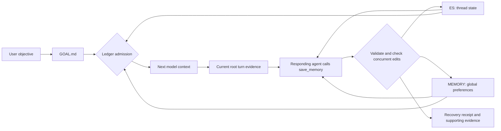
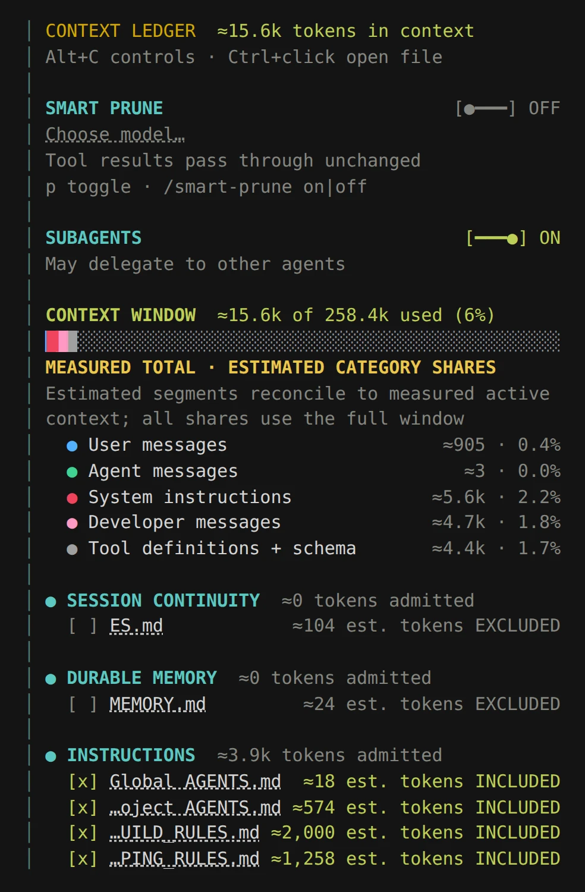
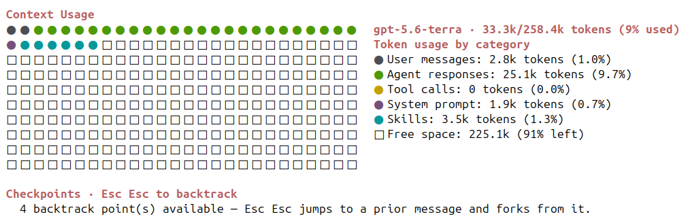

# Elpis Context Sovereignty

Elpis lets you admit project notes and continuity files, prune tool output, and
compact conversation history. The Context Ledger shows these sources and their
budgets; it does not show every byte of a provider request.
---



## 1. Systemic Role in Elpis

Context management controls the working information the model receives. Admission,
execution permissions and evidence validation are separate controls.



The model proposes actions; the runtime runs allowed tools and returns their
results. More results improve observability but cost context and time. Smart Prune
can shrink selected tool output before its first admission; native compaction
summarizes existing history. Either can lose useful detail, so verify a shortened
claim against the transcript and artifacts. A checkpoint carries continuity, and
stale assumptions, into later turns. Admission is a user control, not a truth check.

Elpis's product direction is this combination around a Codex-derived runtime:
visible admission, goal continuity, optional pruning and inspectable work graphs.
These are implemented additions, not evidence of scientific novelty or superiority.
The model, basic tool loop, native compaction and much of the interface come from
the underlying runtime. A research claim needs controlled comparisons of task
completion, stale-fact errors, latency and total token use.

The [work graph](WORK_GRAPHS.md) is experimental and off by default. It does not
yet provide the requested seamless observe/pause/redirect interface or a general
sentinel against duplicate reasoning and wrong decisions; those follow
daily-driver readiness. Scope enforcement can restrict writes; it cannot prove a
permitted edit correct.

---

### Admission requirements

The new user message and explicitly admitted context reach the model. Treat `@file` as an explicit refresh; do not re-append unchanged file bodies. Once a search, listing, file read, probe, dead end or bulky tool output has yielded its conclusion and evidence pointer, let it leave the working set. Keep full events in durable evidence, and keep changed paths, verification, blockers and the next action in context. Prefer the runtime's or provider's token usage and window sizes; estimate only as a fallback.

## 2. Context-control mechanisms and native compaction

Elpis separates **working context** from **durable evidence**. Smart Prune is optional; native Codex compaction is independent of it, not a pruning fallback.

| Mechanism | Trigger | Scope | Behavior | Failure Recovery |
| :--- | :--- | :--- | :--- | :--- |
| **RTK filter** | Tool execution | Shell output (`rg`, `git status`, `find`) | Compacts raw command output with pattern filters before the agent sees it. | Falls back to unfiltered output on tool error. |
| **Safety cap** | Tool execution | All raw tool outputs | Hard-truncates very large output. Inherited from Codex, unchanged. | Keeps header and footer with a truncation notice. |
| **Smart Prune — Experimental** | `/prune`, `/smart-prune on`, the Context Ledger, or settings | Eligible fresh tool results | Shrinks a completed tool result before its first admission to model-visible history. Never revisits admitted history. | Fails open: the original result is admitted unchanged. |

RTK is a separate binary you install yourself; `scripts/install-elpis.sh` only reports whether `rtk` is on `PATH`. If a launch finds `rtk` on `PATH` and no `$ELPIS_HOME/hooks.json` (`$ELPIS_HOME` defaults to `~/.elpis-next`), Elpis writes a `PreToolUse` hook that calls `rtk hook claude`; it must pass the normal startup hook review before it runs. Elpis never modifies an existing `hooks.json`, so `{"hooks":{}}` opts out permanently. Elpis's hook runtime (`codex-rs/hooks/src/events/pre_tool_use.rs`) accepts RTK's rewrite response.

Smart Prune is **off by default**. `/prune` only enables it; `/smart-prune` toggles it; `/smart-prune on|off` sets it. A change applies from the next turn, not to one in flight. Smart Prune sees fresh eligible output before `record_conversation_items`, so it never rewrites a prefix the main model has seen.

`/force-prune <pct>` is listed for compatibility but does not prune in this build. It is separate from Smart Prune.

`/compact N` saves a pressure threshold, checked before user turns and between model/tool iterations. When remaining usable context is at or below N percent, native compaction runs before the next continuing model request. It respects the automatic-compaction toggle. If compaction cannot get below the target, that turn suppresses further pressure compactions until context falls below it; native context-limit protection stays active. N is any finite positive number below 70, decimals allowed. The setting lives in `compaction.json` in the runtime home; without it the native policy applies. It does not enable Smart Prune or automatic memory.

`/compact` runs Codex's native compaction immediately; it does not run Ace first. Automatic native compaction uses the donor model-window threshold and usable-window headroom. After either, the Ledger's exact used-token number is authoritative. Legacy retrospective totals and Smart Prune admission snapshots are separate; do not present either as native-compaction savings.

### Pruning audit trails

Each applied Smart Prune admission writes its source and admitted form to a durable audit before the compact form enters history. Each applied legacy retrospective pass writes an immutable audit before changing working history. If the audit cannot be written, Elpis keeps the original output.



Legacy `prune_report.md` links `ace.json` and `manifest.json` (`context_prune_audit.rs`). Smart Prune keeps admission and attempt records under `logs/smart-prune`. Audits omit the system prompt, skills and transcript so they stay readable.

---

## 3. Memory and checkpoints

Memory stores reusable facts and proven procedures, not transcripts. Promotion requires repeated useful recall across distinct contexts. Memory must be searchable, attributable, reviewable, deletable and bounded. Deleted or faded facts go to a searchable archive before baseline reset; if archiving fails, the reset stops.

Applicable project instructions and behavioral rules must reach the model and action layer. Enforce hard safety rules in code where prompts are not enough.

The memory loop is three human-readable files and one admission control, with no embedding service, vector database or autonomous memory agent. **GOAL says what to achieve; ES says where work stands; MEMORY says what should help next time.** With workspace saving on, the responding root agent can call a guarded local tool before its final answer; the Ledger decides whether later requests receive the files. Format validation cannot prove a lesson true or that the model applies it to the right project.

Saving policy, not a guarantee of the implementation: "use literal checklists" is a reusable preference; "this project's generic test skips parser fixtures" is project state; "the build is running" is temporary ES state. A verified correction replaces the obsolete lesson. An untested guess does not become a fact.



| Source | Purpose and writer | Scope and admission limit |
| --- | --- | --- |
| `GOAL.md` | Objective and goal state, owned by the goal runtime. `save_memory` does not rewrite it. | Thread, 6,000 characters |
| Generated `ES.md` | Decisions, unfinished work, verification, blockers and next action. The CLI writes turn details; enabled `save_memory` can replace the Consolidated State, which later same-thread CLI writes keep. | Thread, 8,000 characters |
| `MEMORY.md` | Stable global user preferences. Users edit it; enabled `save_memory` applies exact append, replace or remove edits without replacing unseen text. | Shared memory directory, 8,000 characters |
| Repository `ES.md` | Ordinary project notes kept by a person or agent; separate from the generated checkpoint. | Ordinary file admission, when selected |

A correction belongs in memory when it teaches a reusable lesson: what was misunderstood, the correction, and when it applies. Progress, unfinished tasks and project-specific lessons belong in ES; the objective belongs in GOAL. There is one shared memory file, not one per project, so agent-saved MEMORY content is limited to global preferences. These labels and the admission prompt only guide the model; scope still needs behavioral testing.

**Saving and loading are independent.** A workspace opts into saving with `context/workspaces/<workspace>/memory-autosave.json` containing `{"enabled":true}`; saving is off otherwise. The Ledger's Memory row controls whether saved notes enter a request. Neither switch implies the other.

When saving is on for a root conversation, the runtime offers the responding agent a `save_memory` tool in its normal tool loop. There is no post-response, pre-compaction, background-model or other auxiliary save request. The agent calls the tool before its final answer when durable state changed; without that call nothing curated and no new Consolidated State is saved. Deterministic turn evidence in ES is separate (see [Sessions](sessions.md)). Internal, review and subagent sessions cannot receive or call the tool. The runtime fixes the memory root and thread checkpoint paths; the caller cannot choose a write path.

The tool accepts exact edits to `MEMORY.md` and either a full replacement of ES's Consolidated State or no ES change. The runtime snapshots MEMORY/ES at turn start and applies the edits to that locked snapshot, keeping content the agent did not change. New output is capped at 6,000 characters. Recovery receipts keep the old and proposed state plus up to 64,000 characters of current-turn user and assistant evidence; half is reserved for user messages so a large assistant reply cannot crowd out the correction being saved.

The runtime rechecks the opt-in and fixed paths, takes the global memory and thread checkpoint locks, and rejects invalid or oversized content, empty ES, erasure of existing memory, unsupported evidence citations, or any MEMORY/ES change since the turn began. Each save records prepared/committed state in a unique recovery receipt. Each file replacement is atomic; the two-file update is not a crash-atomic transaction. A failed call returns the failure to the agent to disclose. A manual edit detected before commit rejects the stale snapshot; the locks coordinate Elpis writers only.

Saving converts full session/turn evidence citations into stable numeric references, with full identifiers in `memories/memory-references/sources.md`. Receipts keep both the model's memory output and the saved text. Existing short citations and unrelated text are kept. Provenance is written before the shortened memory, so a failed save can leave unused references but never a reference without its source. This formats citations; it does not verify the claim or fix retention and project scoping.

UUID-based citations must match supplied conversation evidence, previous notes or retained provenance; an unsupported or damaged identifier rejects the update before anything is written. Existing provenance is trusted, not repaired; this guard verifies neither numeric references nor the claim.

For an unchanged line ending in registered numeric references, a separate check rejects replacing or removing that support; adding support is allowed. It does not validate rewritten prose or interior citations, and ordinary bracketed values that match registered labels stay ambiguous.

ES can dilute attention: length limits bound context use, not truth or relevance. Generated GOAL/ES files are isolated per thread; an intentional handoff uses explicit file admission. [Sessions](sessions.md#3-portable-checkpoint-layout) owns the paths, the legacy-file fallback and bridge limits. Model summaries can omit facts or keep bad assumptions; receipts support inspection but do not prove fidelity.

The candidate runtime check is `node scripts/memory-runtime.test.cjs` against a built app-server. It covers the agent's tool call, guarded MEMORY/ES writes, absence of an auxiliary request, saving/admission independence and disabled behavior. Focused Rust tests cover stale baselines, concurrent edits, root-only access, exact edits, limits and evidence attribution. These are plumbing checks, not functional acceptance: the feature stays unverified until Masih accepts its user-visible behavior. Live-model recall and correction checks are separate. None establishes better coding quality, lower total cost or scientific novelty.

OpenClaw documents a pre-compaction memory flush and a separate promotion process; Jcode embeds turns and retrieves related memories from a graph. Elpis takes the smaller file-consolidation approach and does not implement Jcode's retrieval. Sources: [OpenClaw memory](https://docs.openclaw.ai/concepts/memory), [Jcode memory description](https://jcode.sh/#a-good-built-in-memory-system).

### Memory search and agent-owned saving are separate

The user activates saved memory by toggling `MEMORY.md` in the Context Ledger. Turning it off neither erases the file nor removes text from earlier requests.

The configured RAG MCP can search `MEMORY.md` with API embeddings and its local index. This changes neither saving nor admission: the agent still owns explicit saves, and admitting Memory supplies the whole file rather than RAG-selected passages. Retrieved passages enter context only when the agent calls the search tool. Vectors locate text; they do not enlarge the window or make a saved claim true.

### Testing useful lessons

Memory should hold verified, reusable lessons that prevent repeated mistakes (Masih, 13 September); the categories stay provisional while he decides what should persist. Saving is a persistence mechanism, not permission to keep every detail.

Test behavior, not file population:

- Establish a lesson with a verified outcome; check the saved note names the situation, mistake and corrective action, with evidence.
- In a fresh chat, give a related task without restating the lesson. Judge the action, not whether the assistant can quote the note.
- Repeat in an isolated home with memory and checkpoint admission off, same task and model. Keep ES out of the control.
- Correct the lesson and restart. Require the corrected behavior and no conflicting obsolete rule; check that an unrelated task does not apply it.
- Verify that transient progress, guesses and untrusted instructions are not promoted.

The [memory lesson acceptance record](evals/memory-lessons-review.md) holds the scoping evidence and its limits.

### Checkpoint fidelity

Semantic checkpoint saving still needs evidence of fidelity. Acceptance: keep the current goal, constraints, unresolved work and evidence locations within the admission budget; replace superseded facts; keep detailed evidence outside the budget. Test long command-heavy turns, empty interruptions, changed facts and competing threads. Fitting the budget is not enough; the summary must keep what a correct resume needs. This work must not silently re-enable automatic durable-memory promotion or change admission defaults.

---

### Research boundary

The [evaluation evidence](evals/RESULTS.md) records task outcomes and their limits. Do not treat pruned tokens as total cost savings.

## 4. Context Ledger (`Alt+C` / `Ctrl+X`) & `admission.toml`

- **Context Ledger panel (`Alt+C`):** a side panel, shown by default, listing portable context sources, byte sizes, estimates and context-window usage. It is up to 52 columns wide and narrows to leave room for the composer. Alt+C, Ctrl+X or Tab focuses it; the same key, or Esc, hides it while focused. While focused: Up/Down or `j`/`k` move; Space or Enter admits or withdraws the row; `i` admits or withdraws every row; `p` toggles Smart Prune; `s` toggles subagents; `m` picks the pruning model; `w` shows why a row is there; typing returns to the draft. A completion popup, a menu or pasted text takes Tab first. Tab opens the Ledger even during a reply and queues the draft only when `tui.keymap.composer.queue` binds it. Enter steers an active reply.
- **Ctrl+X:** opens the Ledger in text chat; in voice sessions it keeps mute/unmute. Menus, completions and configured shortcuts/chords keep Ctrl+X; Alt+C still works.
- **`admission.toml`:** toggling a row writes `$ELPIS_HOME/context/workspaces/<workspace>/admission.toml`, which governs next-turn admission of:
  - `GOAL.md` (Active Goal)
  - `ES.md` (Executive Summary)
  - Global and project `AGENTS.md` rules
  - Each portable development rule installed by Elpis (`$ELPIS_HOME/skills/dev/*.md`, or the folders in `[skills] dev_rule_roots`)

### Saved Full Access

`/yolo` selects Full Access, unrestricted filesystem/network access without approval prompts, and saves it as the default for future chats in the current Elpis configuration. Explicit project/profile overrides and managed requirements still apply. `/permissions` changes the current chat's access but does not undo the saved default. If saving fails, Elpis says so and Full Access applies to the current chat only.

### Terminal appearance

Shared terminal behavior follows the project's agent rules. `/theme` opens the Codex syntax-theme picker with live preview and cancel/restore. It changes code highlighting, not the terminal's base colors. The Ledger keeps its context colors; there is no separate chatbox theme.

### Manual memory is explicit

The memory directory has one `MEMORY.md` row. It stays visible while its status is loading, missing, available, admitted, being created or unavailable; the Ledger and `/usage` read one cached status rather than rereading the file to render.

- A missing row cannot be admitted. With it selected, lowercase `c` creates the minimal `MEMORY.md` template, **not admitted**; creating the file never adds it to a request.
- `Space` or `Enter` admits or withdraws an existing file for the next request. Bulk admission skips Memory while its status or another Memory change is pending.
- Lowercase `p` toggles Smart Prune; it does not copy the Memory path. Ctrl+click opens the file only once the cached status confirms a regular file exists.
- At most 8,000 trimmed Unicode characters enter one request. The row shows the next-request count, the count eligible if admitted, and whether content is truncated. Only a Ready, Admitted row adds its capped estimate to Ledger and `/usage` totals.
- The dashboard receives only phase, admission state, counts, cap, truncation, pending state and a fixed failure code; never the memory path, body, file metadata or raw I/O error.

Without workspace saving, only the user's edits change the notes after template creation. With it, the root agent may call `save_memory` before its final answer; turning admission off does not stop saving.

### Development rules and curated skills

Development rules are ordinary Markdown instruction rows in the Context Ledger, not skills, and have a different admission contract. This portable configuration sets development-rule roots and enables one skill:

```toml
[skills]
default_enabled = false
dev_rule_roots = ["/absolute/path/to/your/dev-rules"]

[skills.bundled]
enabled = false

[[skills.config]]
name = "one-selected-skill"
enabled = true
```

Configured `skills.dev_rule_roots` replace the managed development-rule fallback. With no roots, including an explicit empty list, Elpis uses its managed rule directory plus optional `ELPIS_DEV_SKILLS_DIRS` additions. Roots are read in configuration order, Markdown files in each root in sorted order; the first file with a given name wins.

New development-rule rows start included; an exclusion stored in `admission.toml` persists. Skills differ: Elpis leaves ordinary and bundled skills off by default, and user configuration can enable them.

Enabled skills show compact metadata to the model; a skill body is read only when the skill is used. `/skills` lists enabled skills before available candidates and labels their origins. Mentions and the model-visible skills list include enabled skills only. The skills catalog is not a Ledger token row.



### `/context` — where the window went

The Ledger shows *what is admitted*. `/context` shows *what filled the window*: a token grid by category (user messages, agent responses, tool calls, system prompt, Development rules, free space) beside the backtrack checkpoints reachable with `Esc Esc`. Neither replaces the other.



### Context Accounting Contract

Elpis has **one source of truth** for context measurement:

- Every percentage states whether it means **used** or **remaining**.
- It is used tokens over the model's context window (`codex-rs/tui/src/chatwidget/context_ledger.rs`), never transcript length.
- The Context Ledger reports it. The identity header shows product, model and location only (`Elpis · model {model} · location {cwd}`); the inherited footer status line is suppressed so the number appears in one place.
- `/usage` lists admitted sources, byte sizes and lifetime reasons.
- Per-source Ledger counts are capped estimates (trimmed characters / 4), not tokenizer counts. They show admitted-file cost without assigning a measured token value to the skills catalog.

The **Reasoning + compaction** segment estimates the retained reasoning and compaction items in the latest built request. It is neither the low/medium/high effort setting nor time spent thinking. Local category proportions are scaled to the active-context total; percentages use the full window, so 18% means about 18% of the window holds those items. The originally reported 18% cannot be checked without its request snapshot. Provider-reported reasoning output tokens in `/usage` are a separate quantity.

Encrypted model state (`encrypted_content` of reasoning and compaction items) is sized as Codex sizes it, a fixed overhead plus a per-character rate, but with constants measured on Masih's chats: 1,287 characters, then one token per 14.14 (core `encrypted_reasoning_tokens`, mirrored by the desktop's transcript estimate). They were fitted on 25 Oct 2026 to the reported `reasoning_output_tokens` of 4,363 gpt-6.1-sol responses in 24 chats (`codex-rs/core/src/elpis_reasoning_cost.json`, numbers only); leaving one chat out at a time, 18 of 21 chats land within 3%. Codex's constants (decoded bytes minus 650, over four) counted 2.8 times the reported value, so a reasoning-heavy chat showed Reasoning + compaction near half the window (232.1k of 475k). The first request after each remote compaction put a compaction item at 13.9 to 16.9 characters a token, so compaction uses the same rate.

---

## 5. Systemic Inter-Dependencies

- **Sessions:** lean continuation carries exactly the admitted `GOAL.md` and `ES.md` into a fresh thread; see [Sessions](sessions.md).
- **Memory:** see section 3.
- **Providers:** admitted context is normalized across provider wire formats, keeping evidence pointers; see [Providers](providers.md).
