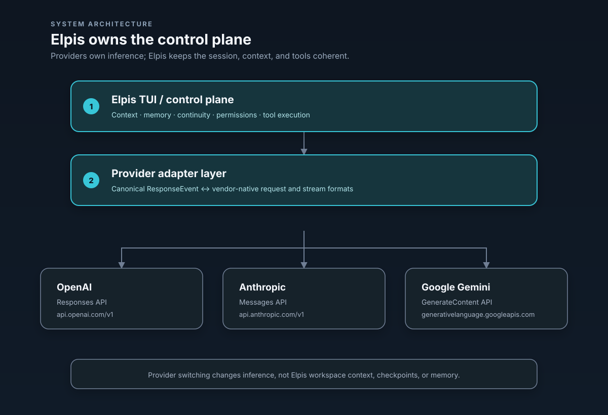

# Providers

Who owns what is [TUI item 2](TUI_SPEC.md#foundation); switching provider keeps context, checkpoints and memory ([sessions](sessions.md)).



## 1. Routes

| Provider ID | API base URL | Key | Protocol |
| :--- | :--- | :--- | :--- |
| `openai` | `https://api.openai.com/v1` | `OPENAI_API_KEY` / OAuth | OpenAI Responses |
| `openrouter` | `https://openrouter.ai/api/v1` | `OPENROUTER_API_KEY` | Chat Completions, through the gateway |
| `anthropic` | `https://api.anthropic.com/v1` | `ANTHROPIC_API_KEY` | Anthropic Messages, through the gateway |
| `google-gemini` | `https://generativelanguage.googleapis.com/v1beta` | `GEMINI_API_KEY` | Gemini `streamGenerateContent`, through the gateway |
| `amazon-bedrock` | `https://bedrock-mantle.us-east-1.api.aws/openai/v1` | AWS credentials | OpenAI Responses |
| `ollama` | `http://localhost:11434/v1` | none | OpenAI Responses |
| `lmstudio` | `http://localhost:1234/v1` | none | OpenAI Responses |

`ollama` and `lmstudio` use a local server, so no request leaves the machine. The experimental `CODEX_OSS_PORT` and `CODEX_OSS_BASE_URL` variables override their port and base URL (`codex-rs/model-provider-info/src/lib.rs`).

Gateway providers list the vendor's own models; a listing that cannot be read yields no models, not invented ones (`codex-rs/elpis-gateway/src/catalog.rs`).

## 2. Keys and launch

`--provider <id>` sets `model_provider` and takes any built-in or `config.toml` provider. Three aliases route through OpenRouter and select its rolling latest-model alias (`codex-rs/cli/src/elpis_provider.rs`):

| Alias | Model |
| :--- | :--- |
| `--provider claude` | `~anthropic/claude-sonnet-latest` |
| `--provider gemini` | `~google/gemini-pro-latest` |
| `--provider gemini-flash` | `~google/gemini-flash-latest` |

```bash
export ANTHROPIC_API_KEY='...'      # or OPENROUTER_API_KEY, GEMINI_API_KEY, OPENAI_API_KEY
elpis --provider anthropic
elpis --provider ollama --model llama3          # no key
elpis --provider openrouter --model tencent/hy3:free
```

A gateway key comes from, in order: a bearer token core attached (`experimental_bearer_token` or command auth), a key saved from the terminal (owner-only `provider-keys.json` in the Elpis home), then the provider's environment variable. Keys never appear in logs or error messages (`codex-rs/elpis-gateway/src/keys.rs`), and native keys are never forwarded to OpenRouter.

## 3. Wire translation

The [Elpis gateway](../codex-rs/elpis-gateway/src/lib.rs) is a loopback server that translates Responses requests into vendor payloads and vendor streams back into Responses events. Adapters: [Chat Completions](../codex-rs/elpis-gateway/src/chat.rs), [Anthropic](../codex-rs/elpis-gateway/src/anthropic.rs), [Gemini](../codex-rs/elpis-gateway/src/gemini.rs).

They translate messages, tool declarations, calls and results, auth headers, streamed text, vendor errors, token usage, model identifiers and completion state. Dropping the response stream stops the parser and releases the upstream body. A vendor silent past the stream-idle timeout fails the stream.

## 4. Limits

- Anthropic receives images (a base64 data URL, or an http(s) URL Anthropic fetches). Gemini and Chat routes replace each image with `[image omitted: this provider route does not carry images]` (`conversation.rs`).
- Tools only OpenAI runs (web search, image generation, tool search, local shell) are dropped, as are history items only the Responses API replays, including remote compaction and OpenAI's encrypted reasoning. Custom (freeform) and namespaced tools go out as plain functions.
- Anthropic `max_tokens` is 8192; adaptive thinking raises it to 32,000 (`xhigh`) or 64,000 (`max`).
- Gemini emits only the first candidate and drops a repeated complete function call.
- The completion event exposes `end_turn`, not the vendor finish reason. A turn that called a tool always has `end_turn = false`. A Chat stream without a finish reason fails; Chat tool calls count under any finish reason except `length`.
- Vendor error statuses pass through to core's retry and rate-limit handling, except 401 and Anthropic's 529 overload (`lib.rs`).
- No real vendor has accepted the adapters yet: [`scripts/provider-gateway-runtime.test.cts`](../scripts/provider-gateway-runtime.test.cts) runs a read-and-patch turn against a loopback fake Anthropic and Chat vendor.

## 5. Manual smoke test

On the remote Rust workflow, not the workstation: set the vendor key, run `cargo run -p codex-tui --bin elpis -- --provider <anthropic|google-gemini|claude>`, check that `/model` lists the vendor's models, then run a text turn and a function-tool turn.
