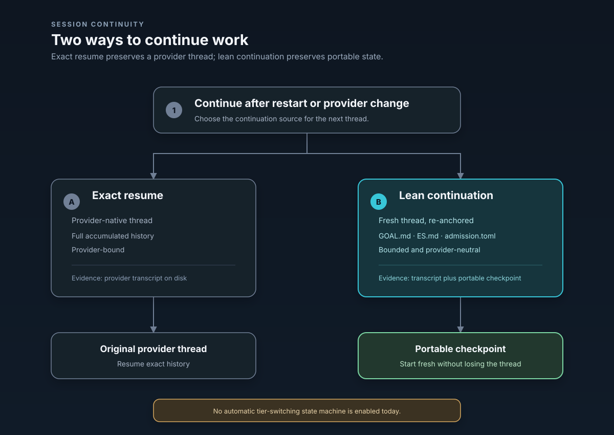

# Session Continuity

Elpis carries work, goals, decisions and evidence across restarts, model switches and compaction without making the model re-read a growing transcript. It carries decisions and evidence, not hidden reasoning, streamed tool events or large outputs.

## 1. Two Continuation Modes

| | Exact resume | Lean continuation |
| :--- | :--- | :--- |
| **What continues** | The provider's native thread (`thread_id`) and its history. | A fresh thread, anchored on an explicitly admitted `GOAL.md` / `ES.md` and applicable rules. |
| **Token footprint** | Grows with turn history until compaction. | Bounded by the per-source character caps in `codex-rs/core/src/elpis_context.rs` ([limits](context.md#3-memory-and-checkpoints)). |
| **Provider mobility** | Bound to the originating provider thread. | Provider-neutral: the checkpoint is plain Markdown, so a provider switch keeps it. |
| **Evidence** | Provider transcript on disk. | Provider transcript on disk, plus the checkpoint. |

Elpis does not switch modes automatically; the threshold is a [deferred decision](GUIDE.md#deferred-decisions).

## 2. How Lean Continuation Is Delivered

Before every turn, `ElpisContinuityExtension` (`codex-rs/core/src/elpis_admission.rs`) contributes one replaceable World State developer section, built by `build_continuity_prompt_with_dev_rule_roots` (`codex-rs/core/src/elpis_context.rs`) for the active thread. It reads only sources admitted in the [Context Ledger](context.md), so a source toggled off stops on the next turn. With nothing admitted the section is empty, which removes the earlier copy. Guardian reviewer sessions do not receive it.



## 3. Portable Checkpoint Layout

Elpis writes `GOAL.md` and `ES.md` to `<runtime-home>/context/workspaces/<workspace>/threads/<thread-id>/`. Thread IDs use the runtime's UUID parser. The workspace key isolates working directories; the thread segment isolates simultaneous chats in one directory. Admission switches and the saving opt-in stay workspace preferences; `MEMORY.md` and its global writer lock stay shared.

An exact resume or model switch in the same thread finds its own files. A fresh thread inherits nothing; to hand work over, `/add` the checkpoint file. A repository's own `ES.md` is an ordinary optional file source.

Elpis never moves or overwrites existing workspace-level GOAL/ES files. A thread with no generated file yet reads the old file only when its first `- Thread:` header names that thread. Clearing such state leaves an empty thread-local file, so the old fallback does not return on resume.

### `GOAL.md`

Written by `write_goal` (`codex-rs/tui/src/elpis_context.rs`):

```markdown
# Elpis Goal

- Workspace: `/path/to/project`
- Thread: `<thread_id>`
- Status: <status>
- Updated: <unix_timestamp>

## Objective

<objective text>
```

### `ES.md`

Written after each completed turn by `write_session_checkpoint` (`codex-rs/tui/src/elpis_context.rs`) from buffered completed items, independent of the provider transcript:

```markdown
# Elpis Session Checkpoint

- Workspace: `/path/to/project`
- Thread: `<thread_id>`
- Turn: `<turn_id>`
- Status: <status>
- Updated: <unix_timestamp>
- Goal: [GOAL.md](GOAL.md) when present

## Latest Result

<final agent message for the turn, or "No final agent result was recorded.">

## Changed Files

- `path/to/file.rs` (modified)

## Commands

- `cargo test` (exit 0)

## Exact Evidence

- Full turn remains in the provider transcript.
```

Both files are written to a temporary path and renamed into place, so a crash mid-write cannot truncate a checkpoint.

With workspace saving enabled, the responding root agent may call `save_memory` before its final answer to replace ES's Consolidated State; [Memory and checkpoints](context.md#3-memory-and-checkpoints) owns its rules. Per thread, a turn-start baseline, a checkpoint lock, size checks and a final concurrent-edit check reject a save when a newer checkpoint appeared first. The bridge CLI save uses the same thread storage but captures its baseline when the tool is invoked, not when the bridge turn starts.

The automatic per-turn write keeps the thread's Consolidated State and records bounded result, file and command evidence. While an agent save holds the thread's checkpoint lock, the TUI defers its write. Unrelated writers do not obey Elpis locks.

An interrupted turn with no result, file or command evidence leaves the thread's checkpoint intact; a first interruption still creates one, and later progress replaces only that thread's file. Concurrent chats keep separate goals, checkpoints, locks and save receipts. The shared memory lock serializes all Elpis memory saves, and a shared memory change invalidates older native baselines.

## 4. Failure Behavior

If writing `ES.md` fails, the turn still completes and the TUI shows `Turn completed, but Elpis could not save ES.md: <error>`.
