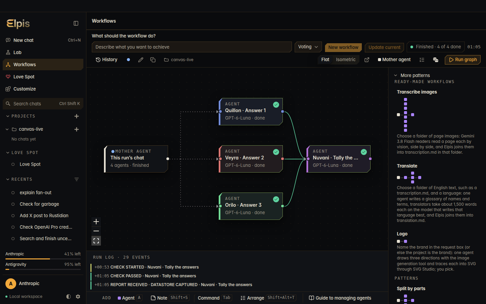
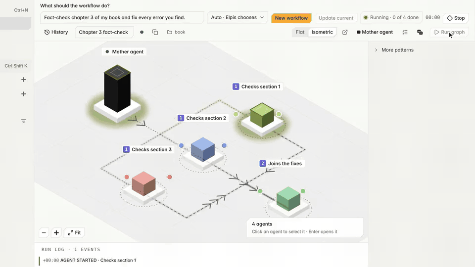
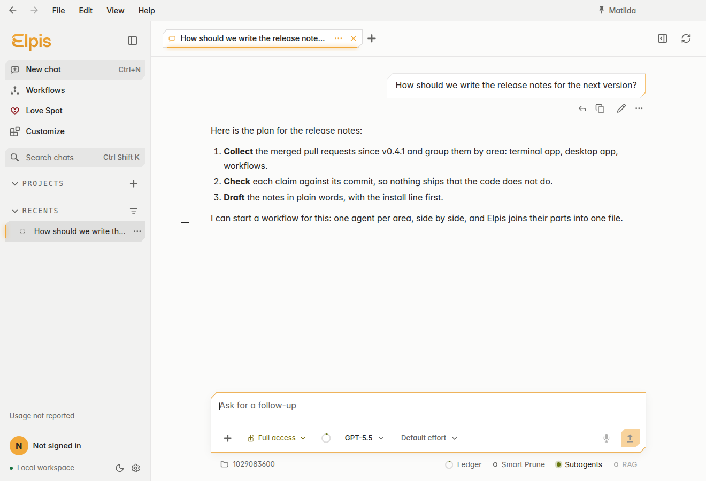

# Elpis

A coding agent should only see what you chose to show it, and a team of agents should only touch what each was given. Elpis is an engineered agent harness for Linux, built on OpenAI's Codex CLI: a home where your agents keep their context, and a board where you design how several of them work together.



[Releases](https://github.com/MasihMoafi/Elpis/releases) · [Website](https://elpis.masihmoafi.com) · [Technical guide](docs/GUIDE.md) · [Contributing](CONTRIBUTING.md) · [License](LICENSE)

## Install

Both apps are for Linux x86_64 and share one engine and one state folder, `~/.elpis-next`. The terminal app is [v0.4.1](https://github.com/MasihMoafi/Elpis/releases/tag/v0.4.1); read the installer before you run it:

```bash
curl -fsSL https://raw.githubusercontent.com/MasihMoafi/Elpis/v0.4.1/scripts/install-elpis.sh | bash
~/.local/bin/elpis
```

The installer checks SHA-256 checksums and installs the terminal app, its Code Mode host and the bundled Linux sandbox; the release also has a Debian package. The desktop app is on the [Releases](https://github.com/MasihMoafi/Elpis/releases) page. Sign in with your ChatGPT or Claude subscription, or set up a provider, then choose a model.

## Why Elpis?

Today's coding agents load every instruction file they find and keep the whole conversation until the window fills; you cannot see what they were told or take it back. Put several of them on one task and it gets worse: they write over each other's files, nobody checks the work, and you merge the result by hand.

Elpis treats both as one problem, **context management**, and answers it with two rules:

- **You choose what each agent sees.** The Context Ledger lists every instruction file, chosen file and memory with its token cost, and you include or exclude each one.
- **Each agent owns what it writes.** In a workflow, every agent has its own folder, a second agent checks its work, and the Mother agent reviews the combined result before anything reaches your project.

## Core features

### Workflows



Describe a job. The Mother agent, the planning agent, either does it herself or designs a team of agents you can see and edit on a board. Ready-made patterns: Sequential, Parallel, Kahn graph waves, Recursive (with a round limit) and Voting; ready-made teams: Transcribe images, Translate and Logo. Past ten agents, a Father agent runs the rest in his own chat and reports to her. Each agent may use a different model, and each is told how much time is left.

**How steps are ordered.** Elpis sorts the board with Kahn's algorithm: an agent starts once everything it waits for, and that work's check, has passed. Agents in one wave run side by side. A loop is refused before any agent starts, unless you choose the Recursive pattern and a round limit. The Voting team below runs in four waves:


**Who may write what: ownership, as in Rust.** Rust lets many readers or one writer hold a value, never both, and checks this before the program runs. Elpis applies the same idea to agents, each a small unit that owns one job:

| Rust | Elpis workflow | Where |
| --- | --- | --- |
| A value has one owner | Each agent owns `agents/<its name>` and the folders you give it. In a Git project it works in its own worktree, and a step that changed files outside its folders fails. | `bridge/workflow-worktrees.mjs` |
| Shared borrows read, never write | Every writer is followed by a check that reads its work and writes only `agents/<name>/check`. A writer without a check is refused. | `lib/canvas.ts`, `bridge/workflow-acp.mjs` |
| No two mutable borrows at once | Two agents linked to work alongside may not share a folder, and an agent that writes the whole project cannot work alongside anyone. Both are refused before the run. | `lib/canvas.ts` |
| The owner decides what lives | The Mother agent reviews the combined commit and must pass it with evidence. Elpis then fast-forwards your project, and refuses if she changed the commit or your project moved. | `bridge/workflow-acp.mjs` |

Two limits remain: two side-by-side agents without an "alongside" link are not yet checked for a shared folder before the run (a Git project still catches the overlap afterwards), and outside a Git project the folders are instructions, not enforced.

**Tested on real models.** A Voting team (three answering agents and one tally agent, each with its own check) finished on GPT-6 Luna through a ChatGPT subscription and on Claude Haiku 5.5 through a Claude subscription, in 74 to 100 seconds; the tally agent used the other three agents' answers. The test is [`tests/canvas-live.runtime.mjs`](apps/elpis-desktop/tests/canvas-live.runtime.mjs).

### Love Spot

A drawing board where Matilda, the app's companion, answers and draws with you. Paste screenshots onto the board and draw on them.


### Chats and the Context Ledger

Chat with GPT, Claude and Gemini models; use your ChatGPT or Claude subscription or an API key, and switch models without losing the thread. Under the composer you choose the Ledger, Smart Prune and subagents. Import chats from Claude Code and Codex.



### The terminal app

The same engine in your terminal. `/add` and `/context` show the working set; the agent saves lasting memory through a guarded local tool, and saving something is a separate choice from sending it. `/compact` takes a pressure threshold or your own instructions. `/model` and `--provider` reach Anthropic, Gemini and OpenRouter beside OpenAI.


## How it works

Elpis keeps the Codex execution and sandbox and adds its controls around the chosen model. The desktop app is Electron with a Node bridge that drives each agent over the Agent Client Protocol. No model weights are bundled. Details: [runtime architecture](docs/GUIDE.md#runtime-architecture), [context](docs/context.md), [sessions](docs/sessions.md), [desktop scope and limits](apps/elpis-desktop/SPEC.md).

State lives in `~/.elpis-next`, or in the folder `ELPIS_HOME` names; an inherited `CODEX_HOME` is ignored. The v0.3.0 state database is incompatible: Elpis refuses it and leaves it untouched.

## Current state

- **Checked by CI:** [release CI](https://github.com/MasihMoafi/Elpis/actions/workflows/embedded-elpis-linux.yml) gates each terminal release on Elpis Rust checks, runtime evals with failing controls, installer checks and clean offline installs. These checks do not prove that Elpis writes better code.
- **Not claimed:** the whole inherited Codex test suite; `/force-prune`, Auto routing and `tui.appearance` are not ported. No macOS or Windows builds.
- **Experimental:** Smart Prune and reasoning expiry. The Mother agent steps in on a failed step (retry, steer or stop) but does not yet steer a healthy run.

## Contribute

Read [CONTRIBUTING.md](CONTRIBUTING.md) to build, test and report a bug. Upstream Codex is Apache-2.0; Elpis keeps its attribution and notices ([LICENSE](LICENSE)).
