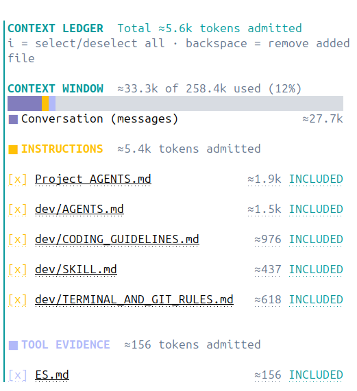
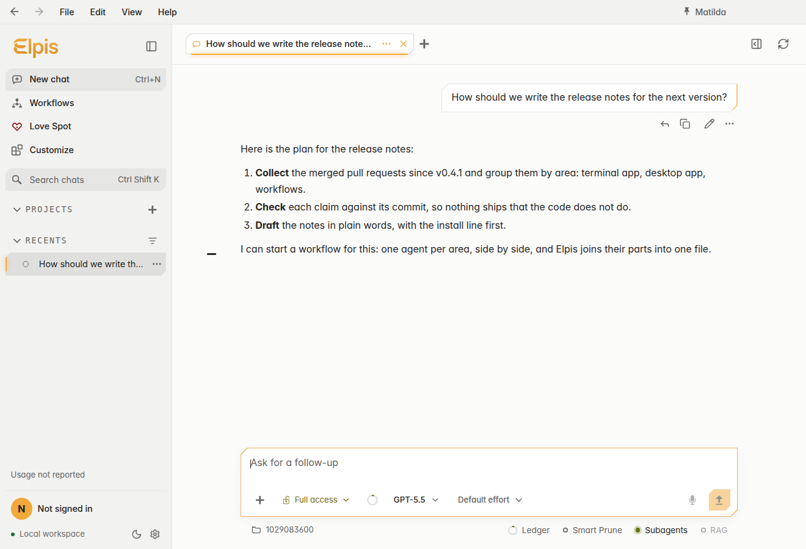
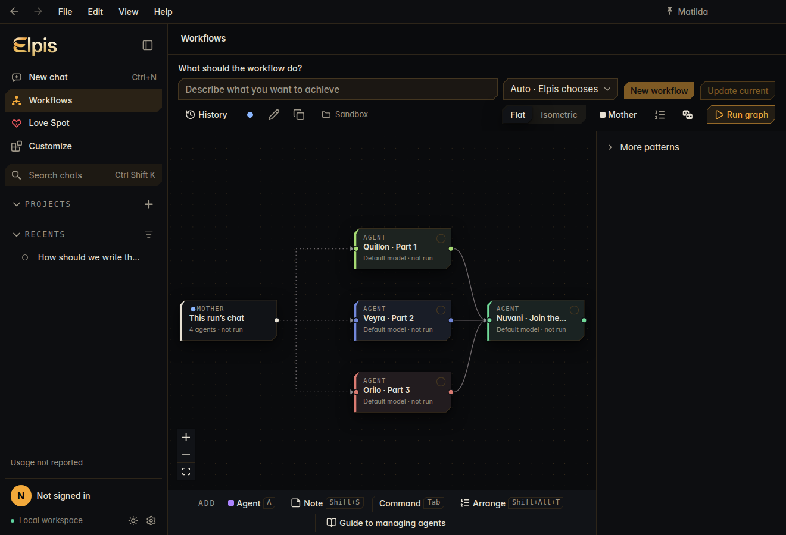

# Elpis

A coding agent should only see what you chose to show it. Elpis is a Linux coding-agent environment built on OpenAI's Codex CLI: you pick the files, instructions and memory that go into each turn, and you can switch the model or provider without losing the thread.



[Releases](https://github.com/MasihMoafi/Elpis/releases) · [Website](https://elpis.masihmoafi.com) · [Technical guide](docs/GUIDE.md) · [Contributing](CONTRIBUTING.md) · [License](LICENSE)

## Install

The terminal app, [v0.4.1](https://github.com/MasihMoafi/Elpis/releases/tag/v0.4.1), is for Linux x86_64 and based on Codex `rust-v0.160.0`. Read the installer before you run it:

```bash
curl -fsSL https://raw.githubusercontent.com/MasihMoafi/Elpis/v0.4.1/scripts/install-elpis.sh | bash
~/.local/bin/elpis
```

The installer checks SHA-256 checksums and installs Elpis, its Code Mode host and the bundled Linux sandbox. The release also has a Debian package. There are no macOS or Windows builds. Sign in or set up a provider, then choose a model with `/model`.

## Why

A coding agent usually loads every instruction file it finds and keeps the whole conversation until the window fills. You cannot see what it was told, and you cannot take it back. In Elpis:

- **Context Ledger:** each workspace instruction, chosen file and memory is listed with its token cost, and you include or exclude it. `/add` and `/context` show the working set.
- **Memory:** the agent saves lasting knowledge and a workspace checkpoint through a guarded local tool. Saving something and sending it to the model are separate choices.
- **Compaction:** `/compact` takes a pressure threshold or your own instructions. Smart Prune and reasoning expiry, both experimental, drop context that is no longer needed.
- **Providers:** `/model` and `--provider` choose the provider. The local gateway serves Anthropic, Gemini and OpenRouter beside OpenAI.

## The desktop app (unreleased)

The desktop app is in development and has no package yet; [CONTRIBUTING.md](CONTRIBUTING.md#building-the-desktop-app) shows how to run it from source. It uses the same engine as the terminal app.

 

- **Chats** with GPT, Claude (through your Claude subscription) and Gemini models, with the Ledger, Smart Prune and subagents under the composer.
- **Workflows:** describe a job and Mother, the planning agent, either does it herself or splits it across a team you can see and edit. Ready-made teams: Transcribe images, Translate (into any of 12 languages) and Logo.
- **Love Spot:** a drawing board where Matilda, the app's companion, answers and draws with you.
- **Import chats** from Claude Code and Codex.

## How it works

Elpis keeps the Codex execution and terminal foundation and adds its controls around the chosen model. No model weights, retrieval engine or speech engine are bundled; other capabilities come through tools or integrations you register. Details: [runtime architecture](docs/GUIDE.md#runtime-architecture), [context](docs/context.md), [sessions](docs/sessions.md).

State lives in `~/.elpis-next`, or in the folder `ELPIS_HOME` names; an inherited `CODEX_HOME` is ignored. v0.3.0's state database is incompatible: Elpis refuses it and leaves it untouched, without migrating it. Keep the old executable if you may need to roll back; the [v0.3.0 guide](https://github.com/MasihMoafi/Elpis/blob/v0.3.0/readme.md) describes that release.

## Current state

- **Released and checked:** the terminal app, v0.4.1. [Release CI](https://github.com/MasihMoafi/Elpis/actions/workflows/embedded-elpis-linux.yml) gates publication on Elpis Rust checks, runtime evals with failing controls, installer checks and clean offline binary and Debian installs. These checks do not prove that it writes better code.
- **Not claimed:** the whole inherited Codex test suite. Appearance and snapshot differences and identity-rename failures remain. `/force-prune`, Auto routing and `tui.appearance` are not ported.
- **In development:** the desktop app ([scope and limits](apps/elpis-desktop/SPEC.md)) and the next terminal release, held by one failing `/worktree` test on CI.

## Contribute

Read [CONTRIBUTING.md](CONTRIBUTING.md) to build, test and report a bug. Upstream Codex is Apache-2.0; Elpis keeps its attribution and notices ([LICENSE](LICENSE)).
