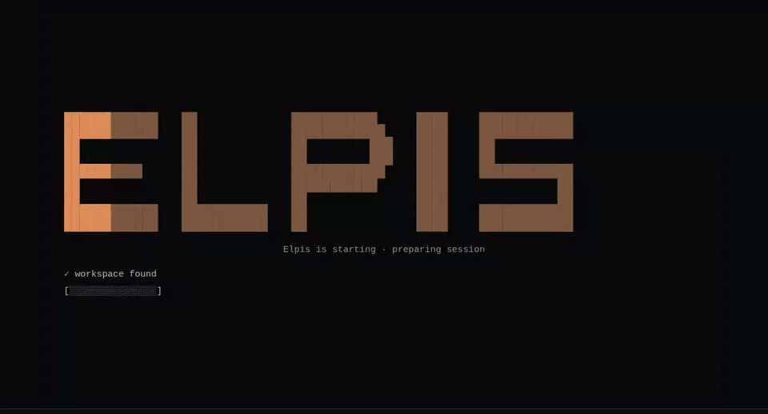
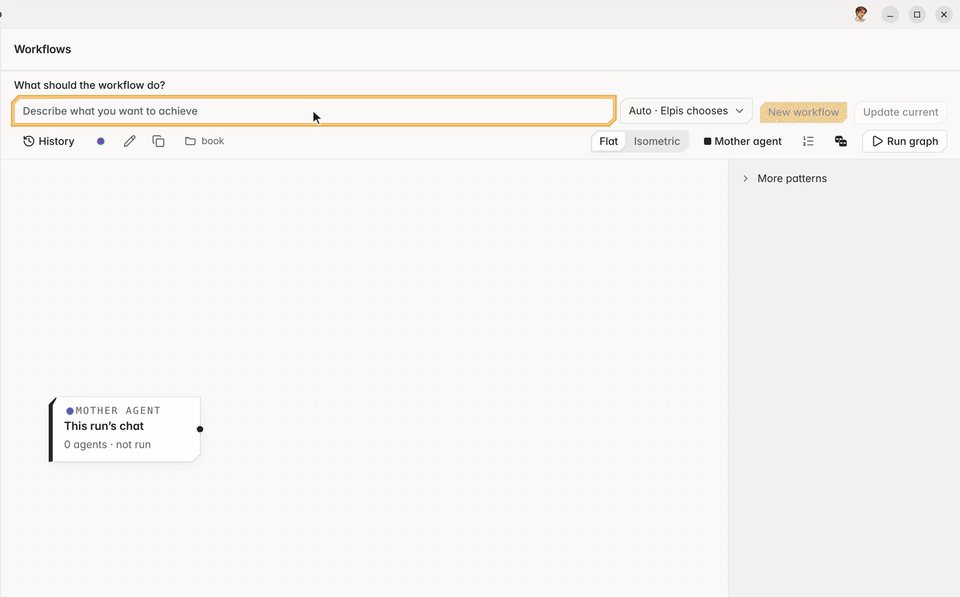
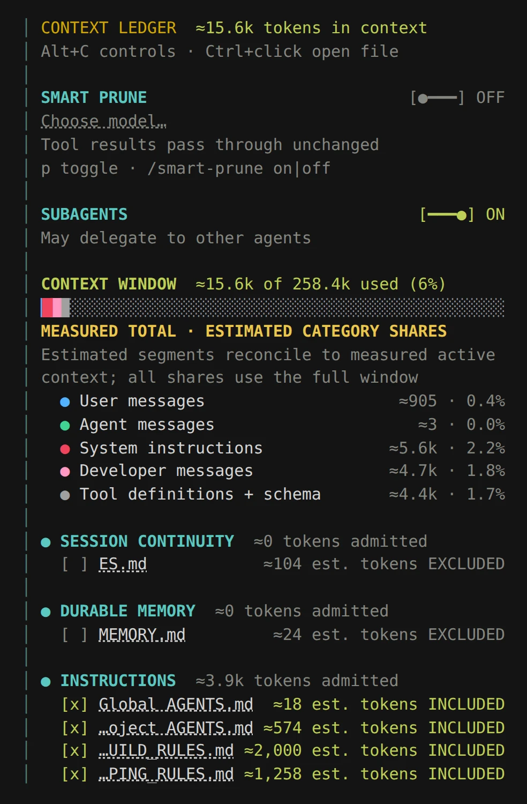
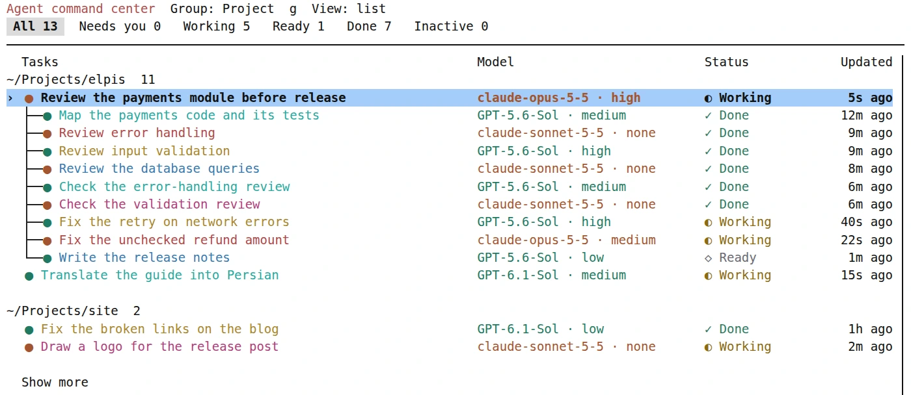
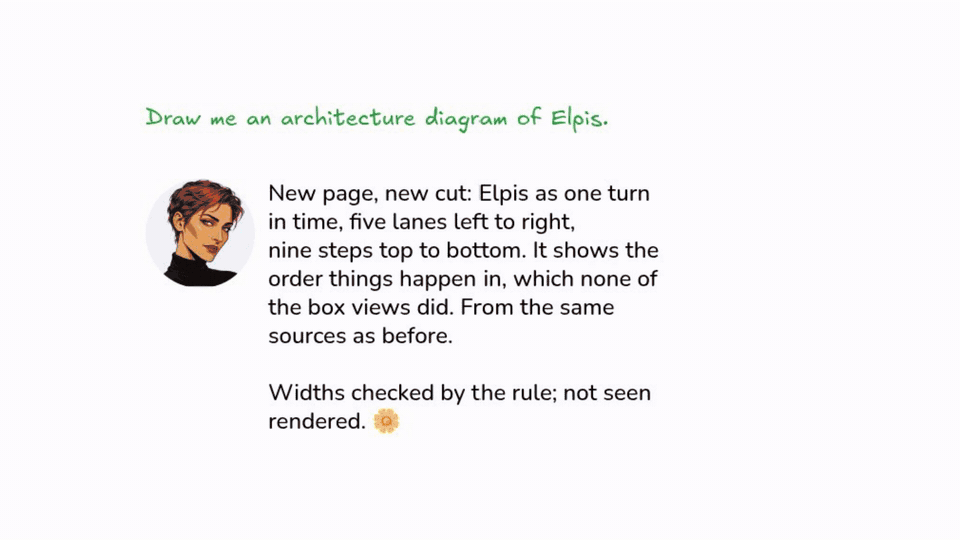
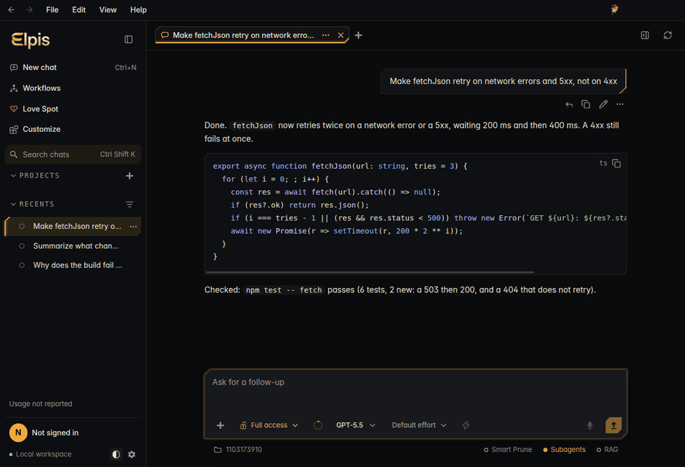
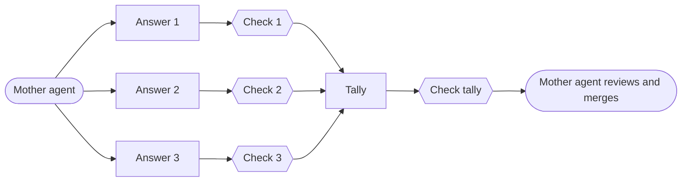

<p align="center">
  <picture>
    <source media="(prefers-color-scheme: dark)" srcset="website/assets/technical/elpis-wordmark-burning-dark.svg">
    
  </picture>
</p>

<p align="center"><b>The ultimate harness: the perfect home for your agents.</b></p>
<p align="center"><i>You put an agent into an Elpis, and it becomes Elpis. Be Elpis, my friend.</i></p>

<p align="center">A coding agent should see only what you chose to show it, and a team of agents should touch only what each was given. Elpis is an agent harness for Linux, built on OpenAI's Codex, for people who run coding agents: a terminal app and a desktop app where you decide what every agent knows, design teams of agents on a board, and watch every step they take.</p>

<p align="center">Alpha · v0.5.3 · Linux x86_64 · in daily use by its author</p>

<p align="center"><a href="https://github.com/MasihMoafi/Elpis/releases">Releases</a> · <a href="https://elpis.masihmoafi.com">Website</a> · <a href="docs/GUIDE.md">Technical guide</a> · <a href="CONTRIBUTING.md">Contributing</a> · <a href="LICENSE">License</a></p>

## Quick start

This command installs both apps, the desktop app and the terminal app, on Linux x86_64:

```bash
curl -fsSL https://raw.githubusercontent.com/MasihMoafi/Elpis/main/scripts/install.sh | bash
```

Then run `elpis-app` for the desktop app or `elpis` for the terminal app. Sign in with ChatGPT or Claude, or set up a provider. Claude models run through your own [Claude Code](https://code.claude.com) install. Open a chat and look at its Context Ledger before you send the first message.

<details>
<summary>Other ways to install</summary>

From the [v0.5.3 release](https://github.com/MasihMoafi/Elpis/releases/tag/v0.5.3); every file has a SHA-256 checksum:

- **Ubuntu, Debian:** `sudo apt install ./elpis_0.5.3_amd64.deb ./elpis-desktop_0.5.3_amd64.deb`
- **Fedora, Arch, Omarchy, any Linux:** `chmod +x Elpis-0.5.3-x86_64.AppImage`, then run it; add `elpis` to run the terminal app.
- **Arch, Omarchy (native package):** `git clone https://github.com/MasihMoafi/Elpis && cd Elpis/packaging/aur/elpis-bin && makepkg -si`
- **Terminal app only:** `curl -fsSL https://raw.githubusercontent.com/MasihMoafi/Elpis/v0.5.3/scripts/install-elpis.sh | bash`
- **Terminal app with npm:** `npm install -g elpis-cli`, then `elpis`. The first run downloads the v0.5.3 release and checks its SHA-256.

Both apps share one engine and one state folder, `~/.elpis-next`.
</details>

## Demo

<p align="center"></p>

<p align="center"></p>

## The problem

Without Elpis, a coding agent loads every instruction file it finds and keeps the whole conversation until the window fills. You cannot see what it was told, and you cannot take it back. Several agents on one task make it worse: they write over each other's files, nobody checks the work, and you merge the result by hand.

Elpis treats both as one problem: the context an agent works in. With Elpis, two rules apply:

- **You choose what each agent sees.** The Context Ledger lists every instruction file, chosen file and memory with its token cost, and you include or exclude each one.
- **Each agent owns what it writes.** In a workflow every agent has its own folder, a second agent checks its work, and the Mother agent reviews the combined result before anything reaches your project.

## How it works

Elpis keeps Codex's Rust engine, its tools and its sandbox, and adds its controls around the chosen model:

- **Context Ledger.** It shows every instruction file, file and memory an agent receives, with its token cost. You include or exclude each one.
  
- **Workflows.** You describe a job. The Mother agent does it herself, or designs a team on a board you can edit. Patterns: Sequential, Parallel, Kahn graph waves, Recursive and Voting.

  

- **Observability.** Every request, tool call, token and cache hit of a chat sits on one timeline: in the desktop app's Observability page, and in the terminal's `/dashboard` (next release).
- **One app for every model.** GPT, Claude, Gemini and OpenRouter, through your ChatGPT or Claude subscription or an API key. You can switch models without losing the thread, and import chats from Claude Code and Codex.
- **Two apps, one engine.** A desktop app (four themes, light and dark) and a terminal app share sessions and state. In the terminal, the Agent command center shows each helper under its parent chat.

  

- **Love Spot.** A drawing board where Matilda, the app's companion, answers and draws with you.

  



The desktop app is Electron with a Node bridge, which drives each agent over the Agent Client Protocol. No model weights are bundled. State lives in `~/.elpis-next`, or in the folder that `ELPIS_HOME` names.

**How a workflow orders its steps.** Elpis sorts the board with Kahn's algorithm. An agent starts when everything it waits for has passed, and the check of that work has passed too. Agents in one wave run side by side. Elpis refuses a loop before any agent starts, unless you choose the Recursive pattern and a round limit. The Voting team runs in four waves:




Details: [technical guide](docs/GUIDE.md#runtime-architecture), [context](docs/context.md), [sessions](docs/sessions.md).

## Current state

The state of each item, with its check and evidence: [production.md](docs/specs/production.md).

- **Verified:** the Voting workflow on two models, and the release checks of each terminal release (both under [Evidence](#evidence)).
- **Under acceptance:** Smart Prune and reasoning expiry are experimental. The codebase dashboard (size, churn, duplicates and agent readiness for any Git project open in Elpis) is built and installed but not yet in a release; its items are in [codebase-dashboard.md](docs/specs/codebase-dashboard.md).
- **Planned:** see [Next](#next).
- **Unsupported:** macOS and Windows builds. Not claimed: the whole inherited Codex test suite.

## What sets it apart

**Who may write what: ownership, as in Rust.** Rust lets many readers or one writer hold a value, never both, and checks this before the program runs. Elpis applies the same rule to agents:

| Rust | Elpis workflow |
| --- | --- |
| A value has one owner | Each agent owns `agents/<its name>` and the folders you give it. In a Git project it works in its own worktree, and a step that changed files outside its folders fails. |
| Shared borrows read, never write | A check follows every writer. It reads the writer's work and writes only `agents/<name>/check`. |
| No two mutable borrows at once | Two agents linked to work alongside may not share a folder. |
| The owner decides what lives | The Mother agent reviews the combined commit. It must pass it with evidence before Elpis fast-forwards your project. |

The tradeoff: outside a Git project the folders are instructions, not enforced.

**What Elpis builds on, and what it adds.** Elpis is a fork of [OpenAI's Codex](https://github.com/openai/codex) (Apache-2.0). Its engine, about 2.3 million lines in `codex-rs/`, carries Elpis's changes but stays close to upstream. Outside the engine the repository holds about 360,000 lines, 13% of its code: the desktop app with its bridge, the workflows, the tools, the website and the scripts. The Context Ledger and the other terminal additions live inside `codex-rs/`. Elpis keeps the attribution and notices of upstream Codex ([LICENSE](LICENSE)). The Observability page is a port of the Trajectory view from [DeepSeek Harness](https://github.com/deepseek-ai/deepseek-harness) (MIT); thank you to its authors.

## Evidence

- **Workflows:** a Voting team (three answering agents and one tally agent, each with its own check) finished on GPT-6 Luna and on Claude Haiku 5.5 in 74 to 100 seconds. The test is [`tests/canvas-live.runtime.mts`](apps/elpis-desktop/tests/canvas-live.runtime.mts).
- **Releases:** [Release CI](https://github.com/MasihMoafi/Elpis/actions/workflows/embedded-elpis-linux.yml) gates each terminal release on Elpis's Rust checks, runtime evals with failing controls and clean offline installs. These checks do not prove that Elpis writes better code.

## Next

- **Matilda as the one agent you talk to.** She routes work to the right agents, sets up workflows, keeps schedules and reminds you, on the model of DeepSeek Harness's super agent.
- **Automations.** Prompts and workflows that run on a schedule, set with a calendar or asked for in one sentence.

[CONTRIBUTING.md](CONTRIBUTING.md) explains how to build, test and report a bug.

<!-- more-projects:start -->
## More projects

- [Rustidian](https://github.com/MasihMoafi/rustidian): a native Markdown notebook for Linux that opens Obsidian-format vaults
- [rag-mcp](https://github.com/MasihMoafi/rag-mcp): local hybrid search over your documents, as a CLI and MCP server
- [Skills](https://github.com/MasihMoafi/skills): SKILL.md workflows for coding agents
- [WhisperType](https://github.com/MasihMoafi/WhisperType): local voice input for developers
- [Read Aloud](https://github.com/MasihMoafi/read-aloud): select text, press Super+R, hear it in a local voice
- [Love Spot](https://github.com/MasihMoafi/love-spot): a shared drawing board where characters talk, draw and compete with you
- [SVG Studio](https://svg.masihmoafi.com): high-quality image vectorization
- [Pin](https://github.com/MasihMoafi/pin): an always-on-top priority note, saved as plain Markdown
- [Clocki](https://github.com/MasihMoafi/clocki): a floating desktop timer for tracking focus hours

All of them: [masihmoafi.com](https://masihmoafi.com/projects)
<!-- more-projects:end -->
